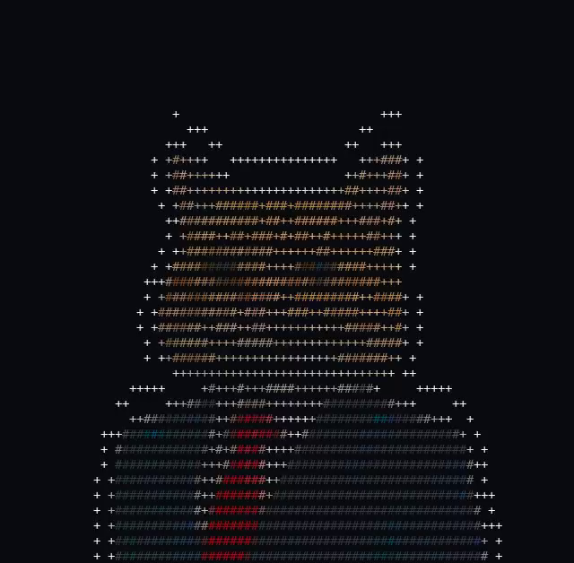

**程序员，AI Agent 开发者。把真正跑得通的方法做成开源项目，让每个想法都能落地。**
**Programmer and AI-agent builder. I turn the methods that actually work into open-source projects, so ideas can ship.**

  
  
  
  

---

## 🕹️ RPD-Skill

**三个入口覆盖项目全生命周期，让 vibecoding 项目真正落地。**
**Three entry points cover the whole project lifecycle, so vibecoding projects actually ship.**

  
  

---

## 📝 LexiNote

**面向 HarmonyOS 的本地 Markdown 笔记与知识整理应用——数据全程留在设备上。**
**A local-first Markdown notes app for HarmonyOS — your data never leaves the device.**

  
  

---

## 🖥️ Termify

  

**这是我的头像经过 Termify 转换后的效果。上传图片、GIF 或视频，生成字符画与终端动画。** 
My avatar, converted with Termify. Turn images, GIFs and videos into ASCII art and terminal animations.

  
  
  
  

---

## 开源贡献 / Open-source contributions

我向开源项目提交过以下修复 PR，涉及 Agent 工具、Windows 兼容性与数据可靠性。 
My submitted pull requests cover agent tooling, Windows compatibility and data reliability.

| 项目 / Project | 我的 PR / My pull requests | 状态 / Status |
| --- | --- | --- |
| [TDD Guard](https://github.com/nizos/tdd-guard)  | [#197](https://github.com/nizos/tdd-guard/pull/197) 验证异常处理、模型配置兼容与 Windows 忽略路径匹配 Validation error handling, model configuration and Windows ignore-path matching |  |
| [MCP Servers](https://github.com/modelcontextprotocol/servers)  | [#4509](https://github.com/modelcontextprotocol/servers/pull/4509) Windows 路径大小写兼容 [#4510](https://github.com/modelcontextprotocol/servers/pull/4510) Memory 原子写入与损坏行处理 [#4511](https://github.com/modelcontextprotocol/servers/pull/4511) Fetch 渐进式 SSR 内容提取回退 Windows paths, memory persistence and SSR content extraction | 三个 PR 均已关闭、未合并 All three closed, unmerged 2026-11-16 |

---

